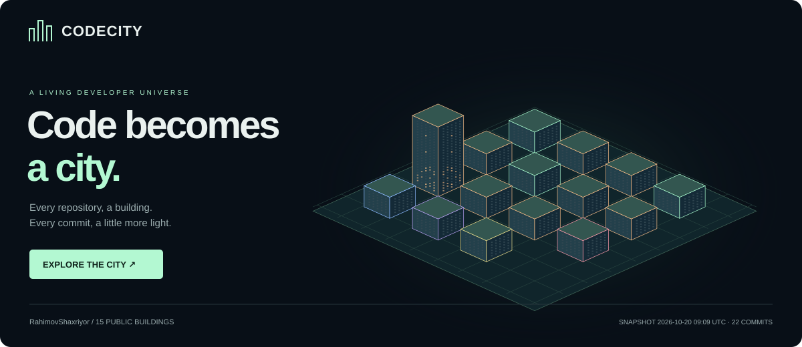

# CODECITY — Living Developer Universe

Авторский GitHub-профиль и интерактивный город публичных репозиториев **Shaxriyor Rakhimov**.



## Быстрый запуск

Нужен Node.js 24+ и npm. В Windows PowerShell при запрете выполнения `npm.ps1` используйте `npm.cmd`.

```sh
npm ci
npm run dev
```

Откройте адрес Vite. В комплекте находится настоящий снимок публичного GitHub API с датой сбора. Для обновления:

```sh
npm run sync
npm run preview:svg
npm run check
npm run preview
```

`npm run build` проверяет TypeScript и создаёт `dist/`. `npm test` запускает встроенный Node test runner без отдельного фреймворка.

## Что внутри

- React + TypeScript + Vite, Three.js без React Three Fiber, postprocessing и UI-библиотек.
- Орбитальная камера с демпфированием, фокусировка на выбранном здании, сброс камеры.
- День/ночь; Lite автоматически на узком экране и при `prefers-reduced-motion`.
- Lite ограничивает DPR до 1, частоту примерно до 30 кадров/с, убирает сглаживание и декоративные рёбра.
- Рендер приостанавливается в скрытой вкладке и вне viewport; GPU-ресурсы освобождаются.
- Окна через `InstancedMesh`; Three.js вынесен в загружаемый отдельно chunk.
- Доступный каталог: поиск, фильтр языка, карточка со стеком языков и topics, описание, GitHub-ссылка.
- Честные состояния: пустой город, недоступные данные, устаревший снимок, WebGL fallback.
- Генерируемый SVG без JavaScript, внешних изображений и `foreignObject`.
- Профиль [PROFILE.md](PROFILE.md), CI, ежедневное обновление и Pages deployment.

## Структура

```text
.github/workflows/
  ci.yml              проверки pull request
  pages.yml           ежедневный сбор, SVG, сборка, Pages
src/
  main.tsx            интерфейс и каталог
  City.tsx            Three.js, камера, picking, lifecycle
  model.ts            типы, валидация, общий визуальный mapping
  style.css           адаптивная дизайн-система
scripts/
  github.ts           GitHub API, пагинация, UTC-агрегация
  sync.ts             атомарная запись публичного снимка
  svg.ts              SVG-рендер
  preview.ts          SVG + профильный README
public/
  city.json           только разрешённые публичные поля
  city-preview.svg    автоматическое превью
  PROFILE.md          готовый текст для профиля
tests/data.test.ts    тесты данных и границ безопасности
docs/
  ARCHITECTURE.md
  DEPLOYMENT.md
  VALIDATION.md
```

## Семантика данных

Один публичный репозиторий владельца — одно здание, включая forks и архивы (с пометками).
Считаются коммиты **всех авторов основной ветки**, включая merge-коммиты, за последние **30 полных UTC-дней**. Это **не** личный contribution graph.

Высота: `floors = 3 + min(12, floor(log2(commits + 1) * 2))`.
Число окон на фасаде: `30 × ceil(floors / 3)`. Каждый пояс повторяет 30 дней:
в первом окне день светится при ≥1 коммите, во втором поясе при ≥2, до ≥5.
Яркость возрастает до 8 коммитов/день. Четыре фасада повторяют одни данные.
Нулевые дни тёмные; неизвестная история серая. Высота неизвестного здания условно минимальная.

Последний опубликованный релиз (включая prerelease, исключая drafts) создаёт корону из 1–4 ярусов, определяемую хешем тега.
Новый тег пересчитывает внешний вид; из-за четырёх вариантов разные теги могут дать одинаковую корону.
Основной язык задаёт цвет. `languages` и `topics` показываются как опубликованы GitHub; наличие фреймворка не выдумывается по языку.

## Развёртывание и ограничения

Подробности: [DEPLOYMENT.md](docs/DEPLOYMENT.md). Репозиторий по умолчанию — `RahimovShaxriyor/codecity`.
В Settings → Pages выберите **GitHub Actions**, затем запустите workflow.
После успешной публикации скопируйте `/PROFILE.md` с сайта в профильный репозиторий.

README GitHub не выполняет JS: [GitHub Markup](https://github.com/github/markup) описывает очистку HTML.
Поэтому профиль показывает картинку-ссылку, а 3D работает на Pages. Изображения могут кешироваться.
Расписание Actions может запускаться с задержкой; в публичных неактивных репозиториях GitHub может отключить schedule после 60 дней.

Значения берутся из API, а не из заранее придуманных статистик. Токен остаётся только в процессе сбора.
Никакие email авторов коммитов, SHA, сообщения коммитов или приватные имена в snapshot не сохраняются.
При полном сбое списка репозиториев deployment останавливается; ранее опубликованная версия остаётся.
Если публичный репозиторий стал приватным, он исчезнет после следующего успешного обновления.
Для немедленного удаления отключите Pages или запустите обновление; старые публичные копии и кеши не отзываются.

Шрифты DM Sans / Space Grotesk загружаются с Google Fonts с системным fallback; для полностью автономного режима удалите CSS `@import` или самостоятельно разместите лицензированные woff2.
